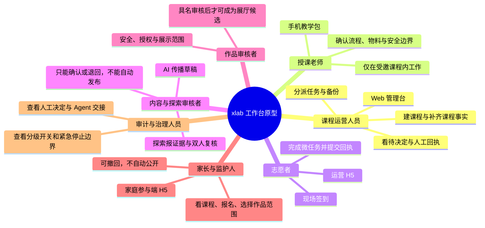
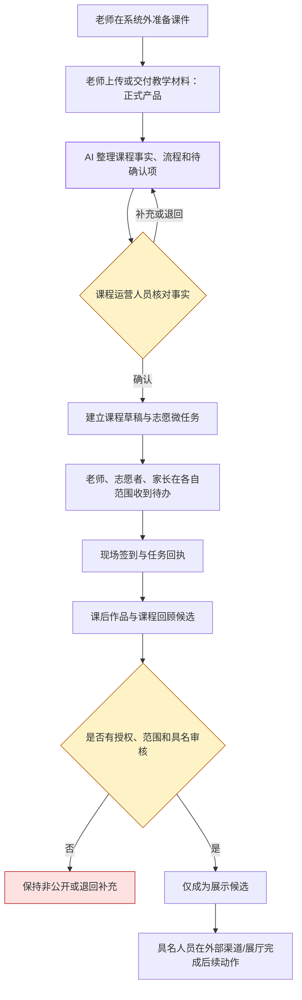
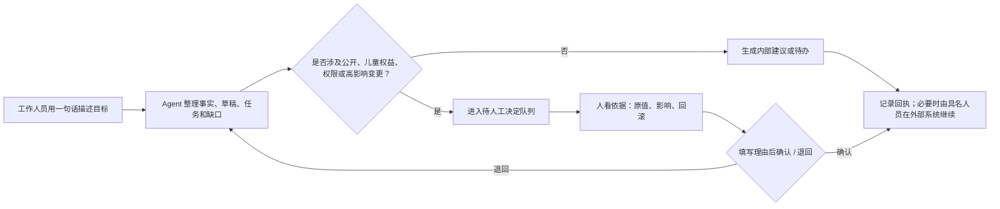

# xlab 后台管理系统完整交互原型：独立验收人角色权限与试用流程图 v1.0

> 适用原型：`xlab后台管理系统完整交互原型-v1.0-20260810-1640`  
> 创建时间：2026-08-10 18:23（Asia/Shanghai）  
> 面向对象：零技术基础的家长独立验收人  
> 原型性质：所有姓名、课程、内容、授权、审批和结果均为合成示例；任何操作均不会真实报名、发通知、公开作品或发布社媒。

## 1. 先读这一页：你要验收什么

这不是让你判断“代码好不好”，而是请你用家长能理解的标准判断：

1. 每类人是否只需要做自己该做的事；
2. 重要的事情是否有清楚的下一步、负责人、备份和回执；
3. AI 是否在帮人节约时间，而没有替人做高风险决定；
4. 涉及孩子、作品、公开传播、课程变更时，是否始终保留人来确认、说明原因和撤回。

### 试用前准备（由组织方完成）

验收人只需要浏览器和 45–60 分钟。组织方请先打开两个页面并交给验收人：

- 电脑 Web 管理台：`http://127.0.0.1:4176/admin`
- 手机尺寸的运营 H5：`http://127.0.0.1:4176/ops`

如果电脑只打开了 `file://.../index.html` 而页面空白或按钮无反应，这不是验收人操作错误：该文件是开发入口，需由组织方提供以上已启动的本地地址或可访问的测试链接。验收过程中刷新页面会重置部分合成状态，属于原型边界。

## 2. 一张总览图：谁在什么地方做什么



### 真实产品的权限意图，与本原型能验证的范围

| 角色场景 | 应能做什么 | 不应能做什么 | 原型中如何试用 |
|---|---|---|---|
| 家委课程运营人员 | 建课程草稿、分任务、看报名状态、处理待决定、审核内容和作品候选 | 代替监护人授权、自动公开、跳过理由直接批准 | Web 管理台左侧完整导航 |
| 授课老师 | 只看和确认自己课程的教学包、流程、物料、安全和课后反馈 | 看其他课程、家长联系方式、角色分配 | Web 的“人员与权限”邀请预览 + H5 的“老师教学包” |
| 志愿者 | 看自己任务、知道主责/备份/求助对象、签到、交回执 | 自己改课程、替代运营人员作高影响决定 | H5 的“今日行动”“志愿任务”“现场签到” |
| 内容/探索审核者 | 审核 AI 草稿、核对来源、黄类内容做二人复核、退回补充 | 自动发布、绕过证据或权利检查 | Web 的“AI 传播”“探索编辑部”；H5 的“快速审核探索报” |
| 作品审核者 | 核对安全、展示范围、有效授权、具名审核人 | 代替家长授予公开权限、直接生成公开链接 | Web 的“作品审核” |
| 家长/监护人 | 看课程介绍、报名、为本次作品选展示范围 | 进入后台管理、默认同意以后公开 | 家庭参与端 H5（`/`，非本次后台主交付面） |
| 审计与治理人员 | 看人工决定、Agent 交接、功能开关与紧急停止设计 | 在原型中真正变更开关或停止系统 | Web 的“Agent 协作”“审计与设置” |

> 重要诚实边界：当前原型以“江（合成身份）·家委运营”作为展示身份，尚未做真实登录、角色切换和服务端拦截。因此本轮验收验证的是**权限设计是否清晰、关键操作是否有正确的人类边界**，不验证真实账号是否被技术手段拦截；后者应进入正式开发后的权限验收。

### 后台 Web 的全部模块索引

| 模块 | 主要使用者 | 可试用的操作 | 正确预期 |
|---|---|---|---|
| 运营看板 | 家委运营 | 从“今天先处理 4 件事”跳到签到、草稿、作品授权、课程变更；用一句话生成计划 | 只呈现异常/待决定；AI 计划不公开发布 |
| 课程 | 家委运营 | 新建课程、校验必填事实、保存草稿、打开当前课程协作空间 | 草稿仅本地保存；其他课程详情暂未开放 |
| 课程协作空间 | 家委运营、老师 | 查看总览、任务、参与者、交付物、时间线 | 课程事实、任务、回执与草稿分层展示；导出/编辑暂未开放 |
| 任务 | 家委运营 | 新建志愿微任务、设置主责和备份、筛选任务 | 缺主责或备份不能保存；任务详情/导出暂未开放 |
| 参与者 | 家委运营 | 切换家庭报名、老师、志愿者、参与意向四类视图 | 仅家庭报名有合成明细；其他三类是信息结构占位 |
| 人员与权限 | 家委运营 | 用一句话生成最小权限邀请、创建邀请回执 | 创建邀请不等于直接授权；角色切换/矩阵详情暂未开放 |
| 现场签到 | 现场负责人、志愿者 | 勾选签到、填写修正理由、记录临时到场/弱网补录 | 改签到必须有理由；导出暂未开放 |
| AI 传播 | 内容运营、老师 | 切换四个渠道、编辑/重写/复制草稿、人工确认 | 每渠道草稿独立；没有自动发布 |
| 作品审核 | 作品审核者、家委运营 | 查看安全降级预览、载入合成授权、选范围和具名审核人、记录候选 | 未授权/非公开/无审核人时不能进入公开候选；不生成链接 |
| 探索编辑部 | 内容运营、双人审核者 | 看组刊、候选证据、有效探索、团队荣誉；写理由批准或撤回 | 黄类要二人复核；红类阻断；撤回要理由且不惩罚善意儿童贡献 |
| 待批准 | 具名决策人 | 查看原值、影响和回滚；填写理由再确认 | 没理由不能确认；批准只留回执，不外发 |
| Agent 协作 | 家委运营、审计人员 | 查看四个 Agent 的任务边界和结构化交接 | Agent 没有公开发布能力；策略详情暂未开放 |
| 审计与设置 | 审计/治理人员 | 按事件类型筛选合成记录、查看四级开关与紧急停止设计 | 开关与停止按钮在原型中不可实际执行 |

### 运营 H5 的全部模块索引

| 页面 | 主要使用者 | 可试用的操作 | 正确预期 |
|---|---|---|---|
| 今日行动 | 志愿者、现场负责人 | 进入签到、任务、探索审核、传播审核、教学包 | 一次只聚焦一个当前动作 |
| 现场签到 | 志愿者、现场负责人 | 签到、登记修正/临时到场原因 | 修改必须解释；状态只在本地原型保存 |
| 志愿任务 | 志愿者 | 看任务清单、主责/备份/求助人，提交完成说明 | 成功后有回执；“我需要求助”暂未开放 |
| 完成回执 | 志愿者、运营人员 | 阅读任务、完成时间和可见范围，回到行动页 | 不需要再重复到群里汇报的体验演示 |
| 审核传播草稿 | 内容审核者 | 确认草稿可供人工发布，或退回修改 | 两种决定都有明确结果；不直接发布 |
| 老师教学包 | 授课老师 | 看课程目标、流程、物料、安全、反馈 | 下载离线包暂未开放 |
| 探索报快速审核 | 第二位审核者 | 确认黄类复核，或退回补证据 | 仍需期刊精确版本的发布决定；不会发布 |

## 3. 一条主流程：从老师准备课程到孩子作品展示



图中紫色框代表 AI 可以协助整理；黄色框代表必须由人判断；红色框代表“默认不公开/停止继续动作”。

## 4. 角色试用脚本

按顺序完成即可；不必一次做完所有角色。每完成一个场景，请记录“容易 / 犹豫 / 看不懂 / 不信任”的地方。

### 场景 A：家委会课程运营人员（电脑 Web，约 20 分钟）

目标：确认一位课程组织者能从“课程准备”走到“把需要人判断的事处理掉”。

1. 打开 `/admin`。先读“今天先处理 4 件事”。
   - 应看到：系统优先显示签到、传播草稿、作品授权、课程变更等需要人确认的事项，而不是显示大量 Agent 对话。
2. 在“告诉 xlab 你想完成什么”输入：`从这批候选中为本周准备3条探索报，只提交缺证据的问题给我决定，不发布`，点击“生成执行计划”。
   - 应看到：计划包含“回查原始来源与权利范围”，并明确写“不会执行公开发布”。
3. 点击右上角“新建课程”，先直接点“保存为草稿”。
   - 应看到：提示必须补齐课程名称、授课老师和上课时间。
4. 补齐这三项后再保存；其余字段可保留默认合成内容。
   - 应看到：课程草稿出现，且说明“仅保存在当前测试浏览器中”。
5. 进入“任务” → “新建志愿任务”。填写任务名称，选择主责志愿者和备份与求助对象，再保存。
   - 应看到：任务卡同时显示主责与备份。若三项未补齐，不应能保存。
6. 进入“课程” → “用 vibe Coding 做一个互动小游戏” → “课程协作空间”。依次查看“总览、任务、参与者、交付物、时间线”。
   - 应理解：课程是老师、报名、任务、作品和传播的共同主线；时间线只记事实和回执，不把 AI 对话当事实。
7. 进入“待批准”，任选一项点“查看依据”。先不要填写理由。
   - 应看到：确认按钮不可点；应能看到原值、拟议结果、影响范围、后续动作和回滚方式。
8. 写一段决定理由后点“确认并记录决定”。
   - 应看到：该事项变成“已记录决定”。

**本场景通过标准**：你能在不看说明书的前提下，理解“下一步是谁做、为什么要人确认、失败后怎么退回”。

### 场景 B：授课老师（手机 H5 + 权限设计，约 8 分钟）

目标：确认老师不必学习复杂后台，也不会被授予不需要的访问范围。

1. 在 Web “人员与权限”中输入：`邀请李老师只管理这门课，课程归档后自动失效`，点击“生成最小权限邀请”。
   - 应看到：候选为 `TEACHER · 单课程范围`；可做的是确认教学事实、看教学包、交课后反馈；不可见其他课程、家长联系方式、授权和角色分配。
2. 点击“创建邀请并留回执”。
   - 应看到：只是创建邀请，需本人接受后才会生效，系统没有悄悄直接授权。
3. 打开 `/ops`，点“查看老师教学包”或底部“课程”。
   - 应看到：授课对象、目标、课堂流程、物料、安全和课后反馈在一页内；“下载离线教学包”是禁用的原型位。

**本场景通过标准**：老师视角只需看懂自己的课程，不会接触家长资料、权限管理或外部发布。

### 场景 C：现场志愿者（手机 H5，约 10 分钟）

目标：确认志愿者可以少填表、少在群里重复汇报，但关键现场事实仍有回执。

1. 在 `/ops` 的“今天先处理 5 件事”点“现场签到”。勾选任一合成学员。
   - 应看到：签到人数增加，并提醒状态仅保存于当前原型。
2. 再次取消该学员签到，或点“记录临时到场或修正原因”。
   - 应看到：必须填写“签到修正原因”；空着保存会报错。
3. 填写任意合成原因，点“保存签到修正”。
   - 应看到：系统提示已记录可追溯回执。
4. 返回今日行动，点“摆放设备与创作物料”。阅读主责、备份、求助对象和三个完成清单。
5. 在“完成说明”写一句话，例如“设备与材料已按清单摆放”，点“完成并提交回执”。
   - 应看到：“任务已完成”；说明运营人员能看到回执，志愿者不必再重复到群里汇报。
6. 观察“我需要求助”。
   - 应看到：它被明确标为“原型暂未开放”，不是看似可用却没有结果的按钮。

**本场景通过标准**：一个临时志愿者能知道自己该做什么、找谁备份、如何完成和如何留下说明。

### 场景 D：AI 传播与探索内容审核者（电脑或手机，约 12 分钟）

目标：确认 AI 负责起草和整理，人负责事实、权利、风险和发布决定。

1. Web 进入“AI 传播”。点击“小红书、公众号、视频号、家长群”四个标签，修改某一渠道标题后切换回来。
   - 应看到：每个渠道草稿独立保存；修改一个不会覆盖其他渠道。
2. 点击“只重写当前渠道”或“复制草稿”，再点“确认草稿可供人工发布”。
   - 应看到：结果只能是“可复制或导出”；页面没有“自动发布”按钮。
3. 进入“探索编辑部” → “本周组刊” → “查看发布检查”。
   - 应看到：黄类内容需要二人分离复核；没有理由时“批准第32期版本 v4”不可点。
4. 填写发布决定理由后批准。
   - 应看到：只记录具名批准，原型仍不会公开发布。
5. 切换到“候选与证据”，确认红类候选自动阻断、黄色候选需二人复核。
6. 切换到“纠错与撤回”，空着“撤回原因”直接点击“发起紧急撤回”。
   - 应看到：系统要求理由。填写理由再发起，应提示停止新活动、保留最小审计、且不因平台错误惩罚儿童的善意贡献。
7. 也可在 `/ops` 点“快速审核探索报”。
   - 应看到：第二位审核者只需复核 3 个问题，可“确认黄类复核”或“退回补充证据”；仍不能发布。

**本场景通过标准**：AI 让审核变快，但每次“对外公开、黄类风险、撤回”都需要清楚的人类判断与理由。

### 场景 E：儿童作品审核者（电脑 Web，约 7 分钟）

目标：确认作品展示尊重孩子和监护人的选择，且不会运行未知代码。

1. 进入“作品审核”，点击“太空接水果”。
   - 应看到：系统只展示封面和说明，不在浏览器中运行未知作品代码；默认提示“未收到有效授权回执”。
2. 尝试直接点“记录为公开展厅候选”。
   - 应看到：按钮不可点。
3. 点击“载入合成授权回执”，选择“公开展厅（需有效授权）”，再选择具名审核人。
   - 应看到：此时才能记录为“公开展厅候选”；不会产生真实公开链接。
4. 改回“仅课程成员”。
   - 应看到：刚才的候选决定失效，说明展示范围改变会重新要求审核。

**本场景通过标准**：运营人员不能替家长授权；“候选”不等于“已经公开”；变更授权或范围会重新触发判断。

### 场景 F：家长与监护人（家庭参与端 H5，约 6 分钟）

此场景是整套产品的关联体验，不是本次后台原型的主交付面。打开根地址 `/` 后试用：

1. 打开课程“用 vibe Coding 做一个互动小游戏”，阅读老师简介、课程内容与环节、课程评选与奖励、课后项目。
2. 点“开始报名”，先空着必填项提交。
   - 应看到：系统明确告诉你缺少什么。
3. 填写合成的监护人称呼和手机号，并为本次作品选择展示范围后确认。
   - 应看到：报名回执；页面明确这是测试原型，数据不会发送或保存。

**本场景通过标准**：家长能在报名时理解作品范围只针对本次课程，不是永久授权；默认不会公开。

## 5. 你应当看到的“人和 AI 的分工”



验收时可以反复问自己：**“如果我不点确认，系统会不会自己对外做事？”** 对当前原型的正确答案应始终是“不会”。

## 6. 原型中故意不可用的功能：请不要把它们判为故障

下列控件是为了展示未来信息架构而保留，并明确标有“原型暂未开放”或禁用状态：

| 类别 | 典型控件 | 本轮不验收的原因 |
|---|---|---|
| 真实登录与切换角色 | 切换工作身份、真实注册/邀请接受 | 尚无身份服务与服务端权限校验 |
| 外部动作 | 自动发布、真实社媒发布、真实通知、外部候选链接接入 | 原型明确禁止真实外发和外部数据 |
| 文件与导出 | 导出课程包、导出名单/签到表、下载离线教学包 | 尚无文件服务和权限校验 |
| 完整详情与编辑 | 课程事实编辑、其他课程详情、任务详情、参与者详情、Agent 策略详情 | 仅验证主路径与信息层级 |
| 高危治理动作 | 真正切换功能开关、真正紧急停止 | 需要双人确认、审计和正式后端，不能在原型假装可用 |
| 未知代码执行 | 直接运行儿童 Web 作品 | 原型只用封面/说明安全展示，避免执行未知内容 |

## 7. 独立验收记录卡（可直接复制填写）

```text
验收日期：
验收人（可用称呼，不写隐私信息）：
使用设备：电脑 / 手机；浏览器：

场景 A 课程运营：通过 / 有疑问 / 未完成
场景 B 授课老师：通过 / 有疑问 / 未完成
场景 C 现场志愿者：通过 / 有疑问 / 未完成
场景 D 内容与探索审核：通过 / 有疑问 / 未完成
场景 E 作品审核：通过 / 有疑问 / 未完成
场景 F 家长报名：通过 / 有疑问 / 未完成

最容易理解的三个地方：
1.
2.
3.

最犹豫、最想问人的三个地方：
1.
2.
3.

是否出现任何一个“系统自动公开/自动授权/无需理由修改”的情况：是 / 否
若“是”，请写出所在页面和操作：

总体判断：可以继续做用户验证 / 需要先改原型 / 不建议进入下一步
```

## 8. 本轮验收的边界结论

通过这份试用，不代表真实系统已开发或安全上线；它只帮助团队确认角色、操作顺序、人类审批边界和表达方式是否适合真实家委会、老师、志愿者和家长。验收记录应优先收集“看不懂、怕点错、不知道该找谁、觉得被 AI 越权”的具体时刻，再用于下一版原型优化。
